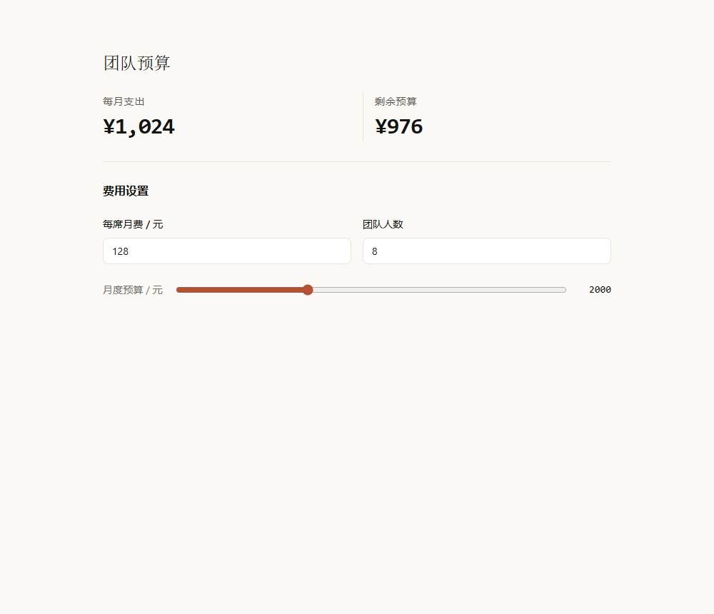
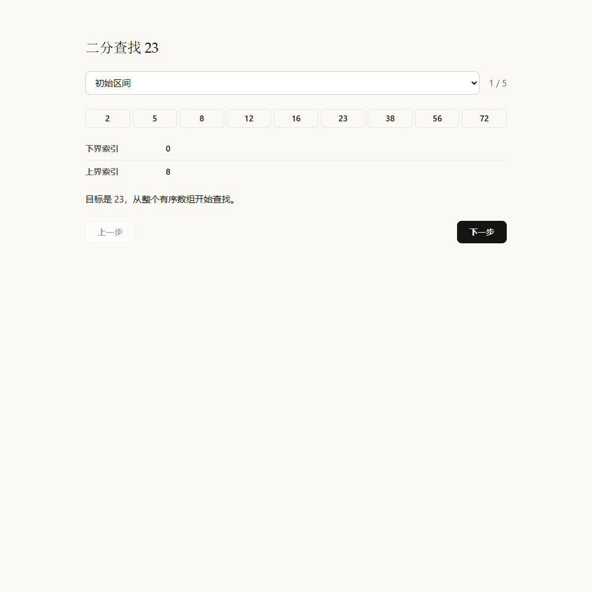

# GenUI / MIKUSCAT

为 DeepSeek Harness 提供克制、清晰的生成式界面。基于
[@changfenhuang/dsh-genui 0.15.0](https://github.com/omdsh-dev/dsh-genui/tree/v0.15.0)
定制，包名为 `@mikuscat/dsh-genui`。

暖白与暖灰、墨色文字、少量陶土色，配合清楚的对齐、分组和间距。默认不生成
装饰性 emoji、眉题、注释小字或仪表盘封面；标签、单位、错误反馈保留正常字号。



## 分步推演与条件计算

`stepper` 一次接收全部阶段，自带上一步、下一步、阶段选择和键盘导航。已访问阶段
保留控件实例，当前位置和带 `id` 的输入可以保存、恢复及导出。每个阶段可以放公式、
数组图解、图表和表格。导航本身不请求模型。



`computed` 与 `plot` 支持比较 `< <= > >= == !=`、逻辑 `&& || !` 和三元表达式
`条件 ? 成立分支 : 否则分支`。只计算选中的分支，例如 `x == 0 ? 0 : 1/x` 在零点
返回 0。比较与逻辑结果为 1/0，条件使用有限数值；未声明名称、循环依赖与任意脚本仍不允许。

模板中心提供「二分查找推演」与「阈值响应」。也可以直接对模型说：

> 用 stepper 分五步演示二分查找，每一步展示数组和搜索区间。

> 用 computed 条件表达式做一个可调阈值的分段响应曲线。

[Release](https://github.com/MIKUSCAT/dsh-genui/releases/latest) 中的 `stepper-light.html`
与 `threshold-light.html` 可下载后离线操作，另附深色版本。

## 安装

在已安装 DSH、Node.js 和 pnpm 的终端执行：

```sh
dsh plugin --profile desktop add "https://github.com/MIKUSCAT/dsh-genui/releases/latest/download/dsh-genui.tgz"
```

如果正在使用上游版，先移除它，避免两套插件同时接管 `dsh-ui`：

```sh
dsh plugin --profile desktop remove @changfenhuang/dsh-genui
```

安装后重新打开 DSH。Web 用户把 `desktop` 换成 `web`。使用
[GitHub Releases](https://github.com/MIKUSCAT/dsh-genui/releases) 中的构建包；
本仓库尚未发布到 npm，直接安装 npm 包名不可用。

例如对模型说：

> 做一个团队预算工具，可以调整每席月费、人数和月度预算。

沿用 `dsh-ui`、`render_ui`、`validate_dsh_ui` 和原有交互状态存储格式。
保留图表、表格、表单、公式、地图、3D、测验、导出与本地计算能力。
旧规格仍可解析，装饰性 emoji 图标字段不再显示；用户正文和数据中的字符保持原样。

## 设计与生成

- [SKILL.md](SKILL.md) 决定何时生成界面、怎样组织内容及默认视觉约束。
- [组件参考](docs/components.md) 按需提供字段、计算表达式与复杂组件用法。
- 暖灰色阶只作用于插件，浅色与深色保持一致的语义层级。
- 默认区块间距 24px；同组控件 16px；标签与控件 8px。支持窄侧栏与文字放大。
- 面板不再显示新手提示小字，成就不自动弹出。导出依赖提示在导出菜单内显示。
- 数值、正文、真实信息不会通过通用正则清洗；限制针对生成规范与装饰性界面字段。

配色参考 [Anthropic](https://www.anthropic.com/) 的公开网站样式；
空间组织参考 [OpenAI UI guidelines](https://developers.openai.com/plugins/concepts/ui-guidelines)。
这是独立维护的 DSH 插件。

## 开发

Node.js 24，pnpm 11.7.0。首次安装：

```sh
npx --yes pnpm@11.7.0 install --frozen-lockfile
npx --yes pnpm@11.7.0 run check
npx --yes pnpm@11.7.0 run preview
npx --yes pnpm@11.7.0 run check:design
```

`check` 执行类型检查、单元测试、构建及独立导出资源检查。
`check:design` 使用已安装的 Chrome / Chromium，检查真实布局、对比度、输入联动、
窄容器和放大字体；可用 `BROWSER_BIN` 指定浏览器路径。测试只使用合成数据和独立浏览器配置。
`preview` 从构建产物生成预算、分步推演和条件计算示例，输出在 `.e2e-artifacts/preview/`。
先生成预览，再运行浏览器检查，以验证实际导出文件中的运行代码。

生产安装包：

```sh
npx --yes pnpm@11.7.0 run pack:verify
```

仓库 CI 在 Linux 执行完整检查和浏览器检查，在 Windows 验证构建。POSIX 安装脚本测试
仅在 Linux 执行。发布流程生成 GitHub Release 安装包及校验文件，不调用 npm publish。

## 来源与许可证

上游：[`omdsh-dev/dsh-genui`](https://github.com/omdsh-dev/dsh-genui)，基线提交
`37c083b7747f5ef4509515fd5d1eb4e972c0e1a5`。保留完整上游历史、
[MIT 许可证](LICENSE) 和 [第三方声明](THIRD_PARTY_NOTICES.md)。
定制变更由 MIKUSCAT 维护；[CHANGELOG.md](CHANGELOG.md) 保留上游历史记录。
